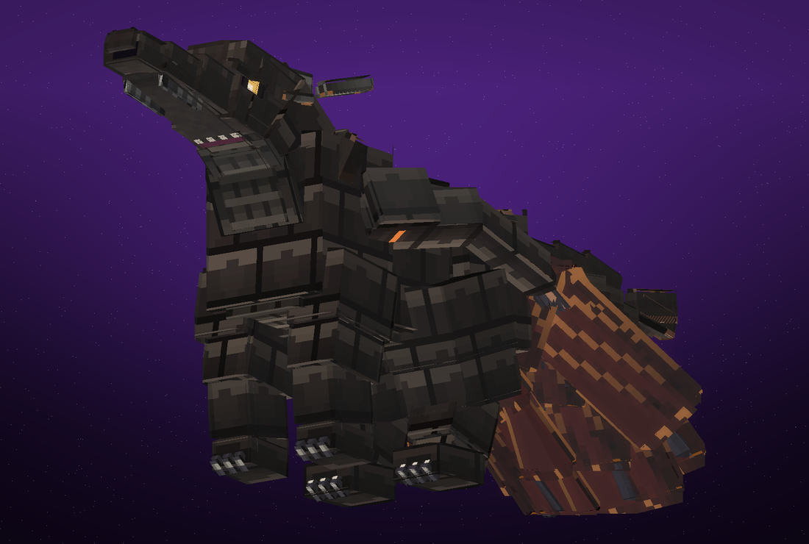
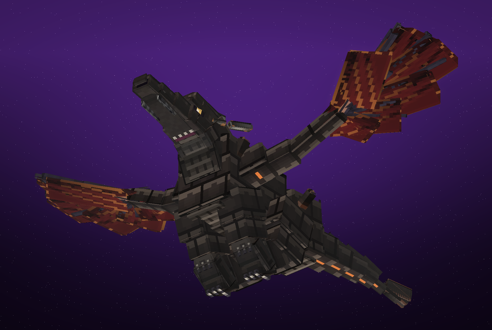
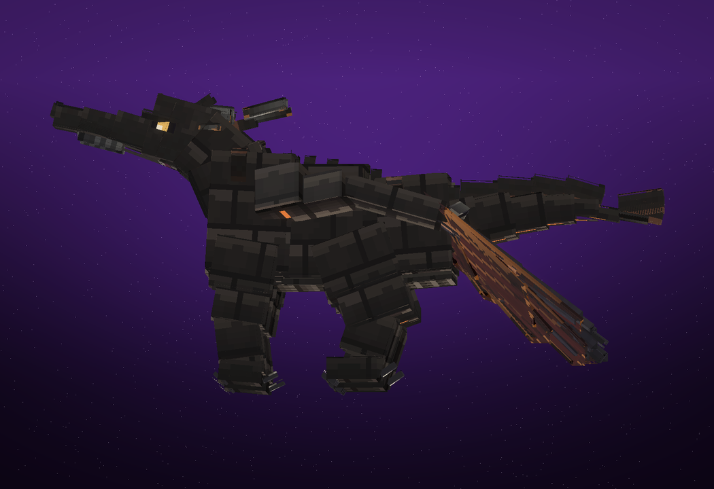
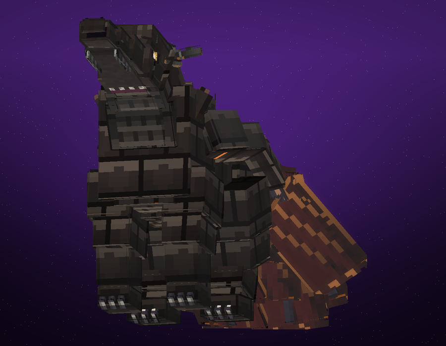

# 🐉 اژدهای پوچی — Void Dragon

**ماد اژدها برای Minecraft 1.21.1 (NeoForge) — رام کردن، بزرگ کردن، زین کردن، سوار شدن و پرواز.**

[](https://github.com/aloArse/voiddragon/actions/workflows/build.yml)

---

## 🖼️ نمای اژدها

| روی زمین | در حال پرواز |
|---|---|
|  |  |

| با زین و زره | از روبه‌رو |
|---|---|
|  |  |

> این تصاویر با رندرر آفلاین خودِ پروژه (`tools/render_preview.py`) مستقیماً از همان مدل و تکسچری ساخته شده‌اند که در بازی استفاده می‌شود.

---

## 🐲 اژدهاها و قدرت‌هایشان

ماد **یک گونه اژدها** دارد، اما سه مرحلهٔ رشد کاملاً متفاوت از نظر قدرت — به‌علاوهٔ اژدهای وحشی و اژدهای رام‌شده که رفتارشان فرق می‌کند.

### ۱) بچه‌اژدها (Void Dragon Hatchling) — مرحلهٔ ۱
> از تخم بیرون می‌آید؛ کوچک، بازیگوش و شکننده.

| ویژگی | مقدار |
|---|---|
| مقیاس مدل | ۰.۴۲ × اندازهٔ بالغ |
| جان | ۴۵ ❤️ |
| آسیب حمله | ۴ |
| زره | ۲ |
| می‌توان سوار شد؟ | ❌ نه |
| می‌توان زین کرد؟ | ❌ نه |

**قدرت‌ها:** نفس پوچی ضعیف (فقط اگر هدف داشته باشد و در برد باشد) + پردهٔ سایه (در تاریکی خودش را درمان می‌کند).
کاربردش: سرمایه‌گذاری روی آینده — با تراشهٔ پوچی و کشتن دشمنان بزرگش کن.

### ۲) اژدهای نوجوان (Juvenile) — مرحلهٔ ۲
> بال‌هایش کامل شده، ولی هنوز توان حمل سوار را ندارد.

| ویژگی | مقدار |
|---|---|
| مقیاس مدل | ۰.۷۲ × |
| جان | ۱۲۰ ❤️❤️ |
| آسیب حمله | ۹ |
| زره | ۵ |
| سوار شدن | ❌ نه (پیام «این اژدها برای حمل سوار خیلی جوان است») |

**قدرت‌ها:** نفس پوچی با برد بیشتر، حملهٔ نزدیک با کوری، پردهٔ سایه، ایمنی به آتشِ اژدها و wither.

### ۳) اژدهای بالغ (Adult) — مرحلهٔ ۳ (کامل)
> اژدهای واقعی: زین می‌گیرد، زره می‌پوشد، پرواز می‌کند و پنج توانایی سوار دارد.

| ویژگی | مقدار |
|---|---|
| مقیاس مدل | ۱.۰ (۳.۳ بلوک ارتفاع تا نوک شاخ، ۷.۳ بلوک از پوزه تا نوک دم، بالِ باز ۱۱ بلوک) |
| جان | ۲۲۰ ❤️❤️❤️ |
| آسیب حمله | ۱۶ |
| زره | ۸ (با **زرهٔ اژدها** می‌شود ۱۸) |
| مقاومت به پرتاب | ۹۵٪ |
| سرعت | ۰.۳۰ (+۴۵٪ هنگام sprint) |

### ۴) اژدهای وحشی (Wild) در برابر رام‌شده
| | وحشی | رام‌شده |
|---|---|---|
| کجا پیدا می‌شود | فقط در **End** (جزیره‌های بیرونی)، تُنُک | هر جا که صاحبش ببرد |
| رفتار | فقط در صورت حمله دفاع می‌کند، سرگردان است | دنبال صاحبش می‌رود، دشمنان صاحبش را می‌زند، اگر جا بماند تلپورت می‌کند |
| رام کردن | با تراشهٔ پوچی (۲۵٪ / روی اژدهای زخمی ۵۰٪) | — |
| وضعیت | با spawn egg یا هچ تخم اژدها هم می‌آید | قابل زین و سوار شدن |

---

## ⚡ توانایی‌های سوار (فقط اژدهای بالغ)

| کلید | توانایی | پیوند لازم | قدرت واقعی |
|---|---|---|---|
| **R** (نگه‌داشتن) | نفس پوچی | ۰ | پرتوی ۲۵ بلوکی که هر ۴ تیک ۵ آسیب می‌زند + کوری + wither، بلوک‌های شکننده (برگ، گیاه، شیشه، تار عنکبوت) را نابود می‌کند، هر تیک ۱.۲ انرژی می‌خورد |
| **G** | حملهٔ پوچی | ۲۵٪ | یورش ۱۶ تیکی؛ در زمین ۳.۰ و در هوا ۱.۷ سرعت، هر هدف ۱۶ آسیب + کوری + کُندی و پرتاب؛ کول‌داون ۷ ثانیه |
| **X** | پرواز | ۴۵٪ | پرواز واقعی با زاویهٔ دید (تا ۵۵ درجه اوج/شیب)، شیفت = شیرجه، اسپرینت = سرعت ۳.۱؛ هاور در جا |
| **V** | غرش پوچی | ۶۵٪ | موج ۱۸ بلوکی: همه را به سمت خود می‌کشد، ۱۲ آسیب، کوری ۱۱ث + ضعف + کُندی؛ کول‌داون ۲۰ ثانیه |
| **C** | گام پوچی | ۸۵٪ | تلپورت تا ۴۴ بلوک از میان دیوارها (با سوار)، فقط روی جای امن؛ کول‌داون ۳۰ ثانیه |

### توانایی‌های همیشگی (passive)
- **پردهٔ سایه:** در نور کم خودش را درمان می‌کند (۲ + مرحلهٔ رشد در هر ثانیه) و به سوارش شب‌بینی می‌دهد.
- **ایمنی:** آتش، wither، نفس اژدها، افتادن، «در دیوار» و سقوط از دنیا (به بالا پرتاب می‌شود).
- **ضربهٔ اژدها** دشمن را ۵ ثانیه در تاریکی فرو می‌برد.
- **وفاداری:** اگر بیش از ۴۸ بلوک دور بیفتد، خودش پیش صاحبش تلپورت می‌شود.
- **نفس/غرش/تلپورت دشمنانِ صاحبش را نمی‌زند** (حتی پت‌های دیگر صاحبش را).

### چطور پیوند (Bond) بالا می‌رود؟
غذا دادن تراشه ۳+ · ضربه زدن به دشمن ۲+ · سوار شدن ۱+ در هر بار · هر ۳۰ ثانیه سوار بودن ۲+ · همراهی ۱+
پیوند کامل (۱۰۰٪) = همهٔ توانایی‌ها باز + شارژ انرژی ۵۷٪ سریع‌تر.

---

## 📥 دانلود فایل ماد (jar)

<details open>
<summary><b>روش ۱ — لینک مستقیم آخرین build موفق</b> (کلیک کن)</summary>

- 🔗 **[کلیک راست → Save link as…](https://api.github.com/repos/aloArse/voiddragon/actions/artifacts/13590786018/zip)** — فایل `voiddragon-mod.zip` را می‌گیری.
- 🔗 صفحهٔ ساخت‌ها: **[Actions](https://github.com/aloArse/voiddragon/actions/workflows/build.yml)** → آخرین build سبز → پایین صفحه بخش **Artifacts** → `voiddragon-mod`.

> اگر این لینک ۴۰۴ داد (چون GitHub artifactها را بعد از مدتی پاک می‌کند)، از صفحهٔ Actions آخرین build را بگیر.
> دانلود artifact نیاز به **ورود به GitHub** دارد؛ اگر روی گوشی سخت است، بگو تا برایت یک Release عمومی بسازم یا فایل را همین‌جا برایت بفرستم.
</details>

<details>
<summary><b>روش ۲ — دریافت مستقیم از چت</b></summary>

بگو «فایل jar را بفرست» تا فایل `voiddragon-1.0.0.jar` را مستقیماً در همین گفتگو برایت بگذارم.
</details>

**داخل zip** یک فایل هست: `voiddragon-1.0.0.jar` — همین را می‌خواهی (اگر zip باز نشد، از ZArchiver استفاده کن).

---

## 📱 نصب روی گوشی (Poco X6 Pro)

1. **PojavLauncher** یا **FCL** را نصب کن (لانچر جاوا برای اندروید).
2. **Java 21** را داخل لانچر نصب کن (برای 1.21.1 اجباری است).
3. پروفایل نسخه: **1.21.1** + **NeoForge 21.1.x**.
4. فایل `voiddragon-1.0.0.jar` را کپی کن در:
   ```
   /storage/emulated/0/Android/data/net.kdt.pojavlaunch/files/.minecraft/mods/
   ```
   (اگر پوشهٔ `mods` نبود، خودت بسازش.)
5. در تنظیمات لانچر حداقل **۲.۵ تا ۳ گیگ رم** بده و رندرر **Holy GL4ES** یا **Zink** را امتحان کن.
6. بازی را با پروفایل NeoForge اجرا کن؛ در `Mods` باید «Void Dragon» را ببینی.

> ⚠️ ماد مخصوص **NeoForge** است؛ روی Forge یا Fabric کار نمی‌کند.

---

## 🎮 راهنمای بازی

### مرحله ۱ — تراشهٔ پوچی بساز
| دستور ساخت | مواد |
|---|---|
| تراشهٔ پوچی ×۲ | echo shard + ender pearl + amethyst shard |
| تراشهٔ پوچی ×۱ | ender eye + obsidian |
| زین پوچی | ۴ چرم + ۴ تراشهٔ پوچی + پشم سیاه (وسط) |
| زرهٔ اژدها | ۴ تراشه + ۴ obsidian + ۱ netherite ingot (وسط) |
| تخم اژدهای پوچی | ۸ تراشه + ۱ تخم اژدها (وسط) |

راه هیجان‌انگیزتر: **تخم اژدها** را با یک تراشهٔ پوچی **راست‌کلیک** کن → یک بچه‌اژدهای رام‌شده بیرون می‌آید. 🐣

### مرحله ۲ — رام کردن
تراشهٔ پوچی در دست بگیر و روی اژدها راست‌کلیک کن (۲۵٪ شانس، روی اژدهای زخمی ۵۰٪).

### مرحله ۳ — بزرگ کردن
| کار | اثر |
|---|---|
| دادن تراشهٔ پوچی | ۴+ رشد، ۳+ پیوند، ۴۰ درمان |
| کشتن دشمن توسط اژدها | ۱+ رشد، ۲+ پیوند |
| سوار شدن / همراهی | رشد آرام با گذشت زمان |

### مرحله ۴ — زین، زره، سوار شو
1. **زین پوچی** → راست‌کلیک روی اژدهای بالغ
2. **زرهٔ اژدها** → راست‌کلیک روی همان اژدها
3. دست خالی → راست‌کلیک → سوار می‌شوی (روی زین می‌نشینی)
4. پیاده شدن: روی زمین **sneak**
5. درآوردن زین/زره: دست خالی + sneak + راست‌کلیک

### کلیدها
**R** نفس پوچی (نگه‌دار) · **G** حملهٔ پوچی · **X** پرواز · **V** غرش · **C** گام پوچی
روی صفحه: نوار انرژی، نوار پیوند و آیکون توانایی‌ها با کول‌داون زنده (مخصوص لمس/گوشی).

### احضار اژدها
با تراشهٔ پوچی در دست، **sneak + راست‌کلیک** → نزدیک‌ترین اژدهای پیوندخورده‌ات پیش تو تلپورت می‌شود.

---

## ⚙️ تنظیمات (`config/voiddragon-common.toml`)

```toml
[gameplay]
  allowFlight = true                 # اجازهٔ پرواز
  voidBreathBreaksBlocks = true      # نفس پوچی بلوک‌های شکننده را نابود کند
  roarAffectsPlayers = true          # غرش به بازیکنان دیگر هم آسیب بزند
  hatchDragonEggs = true             # هچ کردن تخم اژدها با تراشه
  wildDragonsInTheEnd = true         # اژدهای وحشی در End
  abilityCooldownScale = 1.0         # ضریب کول‌داون (۰.۵ = دو برابر سریع‌تر)
  naturalGrowthSeconds = 90          # رشد طبیعی بچه‌اژدها
```

---

## 🧱 ساخت از سورس

```bash
gradle build            # خروجی: build/libs/voiddragon-1.0.0.jar
```

| ابزار | کار |
|---|---|
| `tools/dragon_spec.py` | تنها منبع حقیقت هندسهٔ اژدها (۶۹ مکعب) |
| `tools/gen_model.py` | از spec، کلاس جاوا `DragonRig.java` و UVها را می‌سازد |
| `tools/gen_textures.py` | تکسچر ۵۱۲×۵۱۲ (اژدها، زره، زین، آیتم‌ها، آیکون HUD) را می‌کشد |
| `tools/render_preview.py` | رندرر آفلاین برای دیدن مدل بدون اجرای بازی |
| `tools/pack_source.sh` | آرشیو `voiddragon-source.zip` را که ورک‌فلوی CI از آن build می‌کند همگام می‌کند |

```
src/main/java/com/voiddragon/
├── VoidDragonMod.java / VoidDragonConfig.java
├── ModEntities.java / ModItems.java / ModTabs.java / ModTriggers.java
├── CommonModEvents.java        # attributeها، شبکه، هچ تخم، اسپاون در End
├── VoidShardItem.java          # تراشهٔ پوچی + احضار اژدها
├── network/AbilityPayload.java
├── entity/VoidDragonEntity.java  # حرکت، پرواز، توانایی‌ها، رشد، پیوند
└── client/                     # DragonRig (مدل تولیدشده), مدل/رندرر، کلیدها، HUD
```

---

## 🩺 عیب‌یابی

| مشکل | راه‌حل |
|---|---|
| ماد در لیست نیست / کرش | مطمئن شو پروفایل **NeoForge 1.21.1** است، نه Forge/Fabric/Vanilla؛ Java 21. |
| کلیدها کار نمی‌کنند | Options → Controls → Key Binds → دستهٔ «Void Dragon». |
| اژدها سوار نمی‌شود | باید **بالغ** + **زین‌شده** + **نشسته‌نباشد** باشد. |
| پرواز شروع نمی‌شود | پیوند باید ≥ ۴۵٪ باشد و `allowFlight` روشن. |
| کند روی گوشی | تنظیمات گرافیکی → ذرات را کم کن. |

---

## 🇬🇧 English summary

**Void Dragon** — a complete dragon mod for **Minecraft 1.21.1 / NeoForge**.

One species, three growth stages (hatchling 45 HP → juvenile 120 HP → adult 220 HP); only adults
can be saddled and ridden. Tame with Void Shards, hatch a Dragon Egg with one, grow your dragon by
feeding it and letting it fight. Adults get five bond-gated rider abilities (Void Breath, Void Rush,
Flight, Void Roar, Void Step), passive Shadow Veil regeneration, night vision for the rider, immunity
to fire/wither/fall, and recall-to-owner/loyalty teleports. Includes saddle + armour gear with visible
model layers, wild End spawns, four advancements, an on-screen rider HUD, Persian + English
localisation, a config file, and a hand-built 69-cube animated model with a generated 512px atlas.
