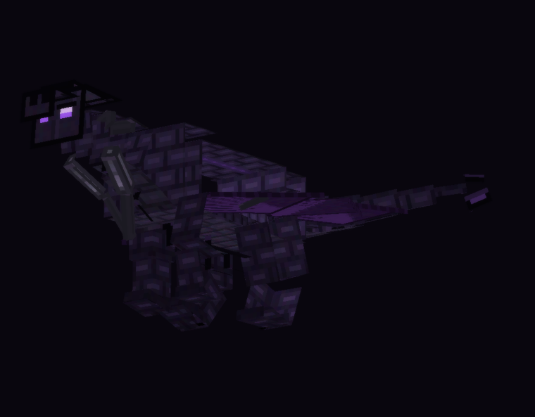
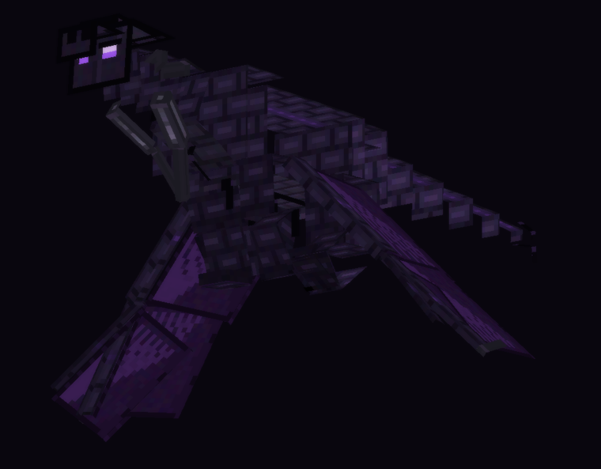

# راهنمای نصب اژدهای پوچی روی گوشی (اندروید)

نسخهٔ بازی: **Minecraft Java 1.21.1** · **NeoForge 21.1.235** · **Java 21**
لانچر: PojavLauncher یا FCL · رم اختصاصی: **۲.۵ تا ۳ گیگابایت**



---

## ۱. گرفتن فایل ماد

### راه سریع — لینک مستقیم (بدون لاگین)

این لینک را تو مرورگر گوشی باز کن؛ فایل `voiddragon-mod.zip`
خودبه‌خود دانلود می‌شود (حدود ۳۶۰ کیلوبایت):

**https://api.github.com/repos/aloArse/voiddragon/actions/artifacts/13666559052/zip**

سپس با ZArchiver (یا هر برنامهٔ فشرده‌ساز) بازش کن. داخلش یک فایل است:

```
voiddragon-1.0.0.jar
```

> مخزن عمومی است، پس این لینک نیازی به حساب گیت‌هاب ندارد. تا وقتی
> artifact زنده است (۹۰ روز) کار می‌کند. برای ساختِ بعدی، شمارهٔ آخرِ لینک
> عوض می‌شود — کافی است از راه دوم یک لینک تازه بگیری.

### راه دوم — از صفحهٔ Actions

۱. برو به `github.com/aloArse/voiddragon/actions`
۲. روی آخرین اجرای سبز (آیکون تیک سبز) بزن.
۳. پایین صفحه، در قسمت **Artifacts** روی **`voiddragon-mod`** بزن.
۴. فایل زیپ را باز کن و `voiddragon-1.0.0.jar` را در بیاور.

## ۲. کپی کردن تو پوشهٔ مادها

فایل jar رو ببر اینجا:

```
/storage/emulated/0/Android/data/net.kdt.pojavlaunch/files/.minecraft/mods/
```

اگر پوشهٔ `mods` نبود، خودت بسازش.
(در FCL مسیر معادلش `.../files/.minecraft/mods/` داخل پوشهٔ برنامه است.)

## ۳. اجرا

لانچر رو باز کن، پروفایل **NeoForge 21.1.235** با **Java 21** رو انتخاب کن و اجرا کن.
اگر بالا نیومد: تو تنظیمات لانچر رم رو به ۳۰۷۲ مگابایت ببر و دوباره امتحان کن.

---

## ۳.۵. این نسخه چه شکلی است

اژدها به سبک اژدهای *House of the Dragon* بازطراحی شده:

* **پوست** زغالی/دوده‌ای با پولک‌های بزرگ و درزهای گرمِ زیرِ پوست (نه بنفش).
* **بال‌ها** چرمی و اُخرایی‌قرمز؛ استخوان‌های بال سیاه و باریک، لبهٔ بال پاره و
  سوزان. روی زمین بال‌ها را توی خودشان جمع می‌کنند و روی پهلوی بدن می‌خوابند؛
  در هوا تا **۱۱ بلوک** باز می‌شوند.
* **جمجمه** دراز و تمساح‌وار با آروارهٔ لولایی، دو ردیف دندان سوزنی، شاخ‌های
  استخوانیِ رو به عقب و خارهای کنارِ گونه.
* **بدن** بشکه‌ای و سنگین روی چهار پای ضخیم، با تیغه‌های پشت از گردن تا دم
  و دمِ پهنِ بیلچه‌ای.
* **ذرات و افکت‌ها** هم‌رنگ شده‌اند: شعله و دود و جرقهٔ کهربایی به‌جای بنفش.



---

## ۴. آوردن اژدها تو دنیا

| کار | چطوری |
|---|---|
| گرفتن تراشهٔ پوچی | تو Creative از تب آیتم‌ها، یا با تخم اژدها (`Void Dragon Spawn Egg`) |
| رام کردن | تراشهٔ پوچی رو بهش بده (راست‌کلیک). هر بار ۲۵٪ شانس — اگه زخمی باشه ۵۰٪ |
| رشد دادن | باز هم تراشه بده؛ مرحله‌ها: نوزاد ← جوان ← بالغ ← پادشاه ← خدا |
| زین کردن | زین پوچی، راست‌کلیک روی اژدهای **بالغ** |
| زره | زرهٔ اژدهای پوچی، راست‌کلیک (۱۰+ زره و ۲۵٪ کاهش آسیب) |
| سوار شدن | روی هر جای بدنش بزن (حتی پا یا دم — برای صفحهٔ کوچک راحت‌تره) |
| احضار از راه دور | تراشه + دکمهٔ Sneak و راست‌کلیک (شعاع ۹۶ بلوک) |

---

## ۵. کنترل‌ها هنگام سواری

همهٔ این‌ها تو **Options → Controls → اژدهای پوچی** قابل تغییرند
(اسم‌ها به فارسی نشان داده می‌شن چون بستهٔ زبان فارسی دارد).

| کلید | پیش‌فرض | کار |
|---|---|---|
| **اوج گرفتن (نگه دار)** | Space | بالا رفتن در حالت پرواز |
| **پرواز** | X | روشن/خاموش کردن پرواز (نیاز: بالغ + پیوند ۴۵) |
| **نفس پوچی (نگه دار)** | R | آتش پوچی — نگه دار تا بسوزاند |
| **حملهٔ پوچی** | G | شیرجهٔ سریع به سمت نگاه (پیوند ۲۵) |
| **غرش پوچی** | V | غرشِ ترساندن (پیوند ۶۵) |
| **گام پوچی** | C | تلپورت به سمت نگاه (پیوند ۸۵) |
| **طوفان پوچی** | B | طوفان ناحیه‌ای |
| **بزرگ / کوچک / خودکار** | `[` `]` `\` | تنظیم دستی اندازه |

حرکت‌های پایه:

* **جهت**: هر جا نگاه می‌کنی می‌ره — برای اوج گرفتن سرت رو بالا بگیر، برای شیرجه پایین.
* **جلو/عقب و چپ/راست**: همان دکمه‌های معمول حرکت.
* **Sprint**: سرعت بیشتر (دو بار زدنِ جلو در حالت لمسی).
* **Sneak (Shift)**: پایین رفتن در هوا؛ روی زمین = پیاده شدن.
* **ثابت ماندن در هوا**: هیچ دکمه‌ای رو نزن — اژدها در جا hover می‌کنه.
* **بلند شدن از زمین**: X رو بزن؛ اژدها خودش دو ثانیه بالا می‌پره.

> **برای صفحهٔ لمسی:** تو FCL/Pojav برو به ویرایشگر دکمه‌ها
> (Control Editor) و برای هر کدوم از کلیدهای بالا یک دکمهٔ روی صفحه بساز.
> بعدش دوربین رو بذار روی **نمای سوم شخص** — تو نمای اول شخص
> سر اژدها جلوی دیدت رو می‌گیره.

---

## ۶. اگر مشکلی پیش اومد

| مشکل | راه‌حل |
|---|---|
| اژدها پرواز نمی‌کنه | باید **بالغ** باشه و **پیوند** به ۴۵ رسیده باشه (با تراشه بیشتر بده) |
| پیاده نمی‌شم | روی زمین Sneak رو بزن — تو هوا Sneak یعنی پایین رفتن |
| ماد بالا نمیاد | NeoForge باید دقیقاً 21.1.235 باشه و Java 21؛ فایل jar نباید تو پوشهٔ فرعی باشه |
| لگ دارم | رم رو به ۳ گیگ ببر و اندازهٔ اژدها رو با `[` کوچیک کن |
| اژدها تو زمین گیر کرده | یک بلوک بالاتر teleport کن یا تراشه + Sneak برای احضار |
| گم شد | تراشهٔ پوچی + Sneak + راست‌کلیک — از هر جای دنیا (تا ۹۶ بلوک) برمی‌گرده |

---

## ۷. برای سازنده: تغییر دادن ظاهر اژدها

هندسه فقط در یک فایل است: `tools/dragon_spec.py` (`tools/measure.py` اندازه‌ها را چاپ می‌کند)

```bash
python3 tools/gen_model.py      # می‌سازد DragonRig.java
python3 tools/gen_textures.py   # می‌سازد اطلس بافت‌ها
python3 tools/measure.py        # اندازه‌های استخوان‌بندی را چک می‌کند
python3 tools/render_textured.py  # پیش‌نمایش
```

بعد از هر تغییر در اندازه‌ها `tools/measure.py` را اجرا کن؛ اگر چیزی داخل
یک قطعهٔ دیگر دفن شده باشد (هیچ‌وقت دیده نشود) در خروجی مشخص می‌شود.
